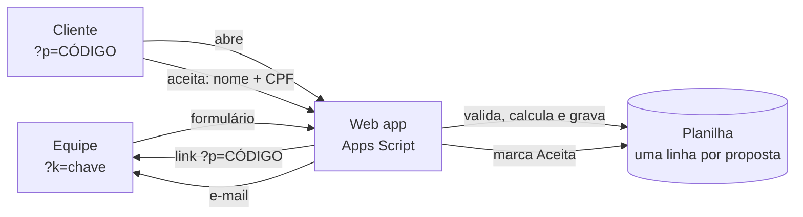

# Gerador de Propostas (Apps Script)

[](https://github.com/FIlIpeDiBr/gerador-propostas-apps-script/actions/workflows/ci.yml)

Web app em Google Apps Script que gera propostas comerciais de honorários. A equipe preenche um formulário, o sistema calcula o valor por uma tabela (regime tributário, setor, faixa de faturamento, quadro de pessoal) e devolve um link curto. O cliente abre o link, lê a proposta e aceita informando nome e CPF; o aceite fica registrado em uma planilha e a equipe é avisada por e-mail.

Foi construído para um escritório de contabilidade. Está aqui sem a identidade do escritório: nome, contatos, textos e **todos os preços** são exemplos.

*[English version](README.en.md)*

## Como funciona



Há três formas de preço: honorários calculados pela tabela (Simples Nacional e Lucro Presumido), valores informados à mão (Lucro Real) e planos de preço fixo para holdings.

## Decisões de engenharia

**Só duas funções atendem o navegador.** No Apps Script, toda função global sem `_` no fim pode ser chamada por qualquer visitante do web app. Aqui o formulário chama `gerarLinkProposta`, que exige a chave da equipe, e a proposta chama `aceitarProposta`, que exige o código. Um teste falha se outra função ficar pública, e outro confere que cada página chama só a que lhe cabe.

**O gerador não abre para quem só tem o link de uma proposta.** O formulário e a proposta vivem na mesma implantação. Sem a chave da equipe na URL, tirar o código do link leva a um aviso de acesso restrito, não ao formulário.

**O link carrega só um código.** Os dados ficam na planilha, então não há o que adulterar na URL. O código tem 10 caracteres de um alfabeto de 32 (50 bits), sai do hash de UUIDs (`Math.random` é previsível) e dispensa `0/O` e `1/I`, que se confundem quando alguém dita o código.

**Dinheiro em centavos inteiros.** A soma de parcelas em ponto flutuante erra no último centavo. O total é sempre a soma exata das linhas mostradas, e um teste confere isso com valores escolhidos para dar errado em `float`.

**Uma tabela de preços só.** O formulário recebe a tabela do servidor ao abrir. A prévia que a equipe vê e a proposta que o cliente recebe saem dos mesmos números.

**O servidor valida tudo de novo.** O navegador valida para dar retorno rápido; quem decide é `validarFormulario_`, que confere tamanhos, faixas, datas que existem e os dígitos verificadores do CNPJ, inclusive o alfanumérico (em vigor para novas inscrições desde julho de 2026).

**A validade da proposta vale de verdade.** A proposta vale até a data de emissão mais os dias informados. Vencida, ela continua legível, mas o aceite é recusado. A comparação lida com a célula tanto como texto quanto como `Date`, porque o Sheets converte sozinho o que tem cara de data.

**O aceite mostra o que aconteceu.** A página só exibe "proposta aceita" depois que o servidor confirma a gravação. O aceite relê a linha dentro de um lock, então dois cliques não geram dois registros nem dois e-mails, e quem reabre o link vê a proposta no estado em que ela está.

**CPF: completo na planilha, mascarado no e-mail.** A planilha é o registro do aceite. O e-mail de aviso leva `***.982.247-**`, o bastante para conferir sem espalhar o número pela caixa de entrada.

## Estrutura

| Arquivo | O que tem |
|---|---|
| `src/config.gs` | Marca, tabela de honorários, planos e limites (tudo fictício) |
| `src/validacao.gs` | Validação do formulário no servidor |
| `src/calculo.gs` | Cálculo da proposta, puro e em centavos |
| `src/formato.gs` | Dinheiro, datas, CPF e CNPJ |
| `src/armazenamento.gs` | Planilha, código curto, aceite, faxina |
| `src/webapp.gs` | `doGet`, `gerarLinkProposta`, `aceitarProposta` |
| `src/setup.gs` | Configuração inicial e e-mail de aceite |
| `src/Gerador.html` | Formulário da equipe |
| `src/Proposta.html` | Proposta que o cliente recebe |

## Publicando

Pré-requisitos: uma conta Google e o [clasp](https://github.com/google/clasp).

```bash
cp .clasp.json.example .clasp.json   # preencha o scriptId do seu projeto
clasp push
```

No editor do Apps Script:

1. Rode `inicializar`. Ela cria a planilha de propostas, gera a chave da equipe e escreve tudo no log de execução.
2. Em Configurações do projeto, crie a propriedade `EMAIL_ACEITE` com o endereço que recebe os aceites.
3. Implante como app da Web (executar como você, acesso para qualquer pessoa).
4. Abra `URL?k=<chave>` para gerar a primeira proposta.
5. Opcional: crie um gatilho diário para `limparPropostasExpiradas`.

Marca, tabela de honorários e planos ficam em `src/config.gs`.

## Testes

```bash
npm test
```

São 42 testes com o `node:test`, sem dependência nenhuma. Os arquivos `.gs` são carregados em um contexto isolado com dublês para planilha, propriedades, lock e e-mail, e com o relógio controlado pelo teste. Cobrem o cálculo (limites de faixa, adicionais de pessoal, Fator R, Lucro Real, holding), a validação do formulário, CPF e CNPJ, o caminho gerar → abrir → aceitar, a validade, o aceite repetido, a falha do e-mail e da planilha, a faxina e a lista de funções públicas. As duas páginas são renderizadas com os dados do servidor e o script de cada uma é compilado.

O CI roda a suíte no Node 20 e 22.

## Limitações conhecidas

- A chave da equipe é uma só e vai na URL. Não há usuário por pessoa nem registro de quem gerou cada proposta.
- O aceite é um registro (nome, CPF, data e hora), não uma assinatura eletrônica. A proposta avisa que o contrato definitivo vem depois.
- A tabela de preços fica no código. Mudar um valor pede uma nova implantação.
- A planilha é o banco, e a busca pelo código lê a coluna inteira. Serve para o volume de um escritório, não para milhares de propostas por dia.
- Os testes usam dublês dos serviços do Google. Nada roda contra o Apps Script de verdade, e do navegador só são testados o render e a compilação do script.

## Autor

Filipe Dias Brandão · [github.com/FIlIpeDiBr](https://github.com/FIlIpeDiBr)

Código publicado para fins de portfólio. Todos os direitos reservados.
